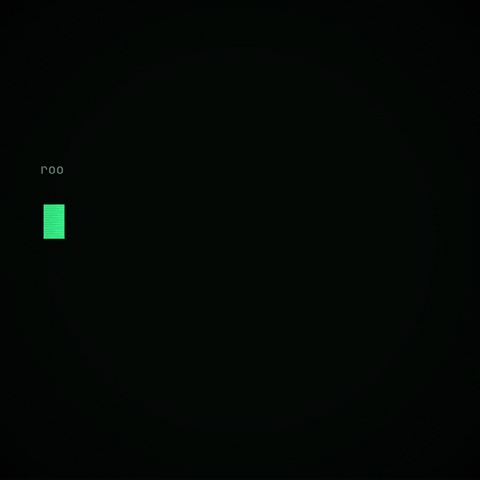

<p align="center">
  <a href="media/trailer.mp4"></a>
</p>
<p align="center">
  <a href="https://morronel.github.io/requests_please/"><b>▶ Play in your browser</b></a> · <a href="media/trailer.mp4">Watch the teaser with sound</a>
</p>

# Requests, Please

A mobile-first WAF simulator. Papers, Please, but you're the web application firewall.

You're on night shift at Edge Node 7 after the board fired the ML firewall. HTTP requests land on your desk one by one. Tap values to decode them, look up IPs, read the endpoint notes, then **ALLOW** or **BLOCK** (and say which attack it was). Growth wants zero blocked customers, the CISO wants zero breaches, and two meters make sure you can't fully please either.

## Features

- **Endless mode** in three difficulties: Easy (Intern), Medium (SOC Analyst), Hard (Red Team's Nightmare).
- **13 attack classes** with real payloads: SQLi, XSS, path traversal, scanners, command injection, SSRF, credential stuffing, open redirect, SSTI, Log4Shell, XXE, JWT tampering, request smuggling. Plus **policy** violations against the shift's directives.
- **Bait traffic** that looks scary but isn't (hello, Mr. O'Brien).
- **Decoder tray**: URL, Base64, HTML entities, hex escapes, stacked up to 3 layers on Hard. JWT inspector, IP lookup, rate graph, endpoint notes.
- **Fixed 3-minute shifts** with a quota of correct calls to keep the job, a relaxed per-request timer (the WAF fails open if it runs out), and a speed bonus for fast correct calls.
- **Directives** that pile up each shift, Papers, Please style.
- **Rule writing** by tapping, with a live dry run against sample traffic.
- **Patch reviews**: pick the real fix out of three PRs (one is a blacklist, one breaks prod).
- **Codex** that unlocks an explainer for each attack you meet.
- Thumb-sized controls, swipe right to allow / left to block, a short undo, haptics, keyboard shortcuts (`A`, `B`, `1`-`0`, `U`).
- **English or Ukrainian** interface, lore and dialogue (the 🌐 chip on the menu). HTTP requests always stay in English.
- Offline-capable PWA, no backend. High scores live in your browser.
- **Radio** with three stations (lo-fi, drum & bass, blues & jazz), each a ten-minute tape of four tracks, plus short sound effects. Everything is synthesized live with the Web Audio API (`src/audio`), so there are no audio files and nothing to license.

## Development

```sh
npm install
npm run dev      # local dev server
npm test         # engine tests (Vitest)
npm run build    # type-check and build to dist/
```

The game logic lives in `src/game` and has no UI dependencies. Requests are generated from templates in `src/game/templates.ts` with a seeded RNG, so new attacks or bait are a few lines each. The UI is Preact in `src/ui`.

Text goes through `t()` from `src/i18n`, gettext style: the English string is the key and `src/i18n/uk.ts` maps it to Ukrainian. `npm test` fails if any English string shown to the player has no Ukrainian translation.

Add `#debug` to the URL to expose the current run as `window.__run` for automated playtests.

## Subscribe To My Telegram Channel

https://t.me/binary_xor
